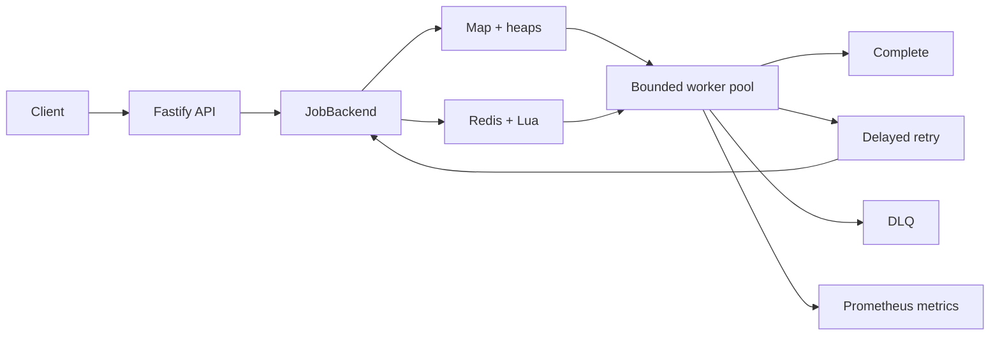

# Priority Job Queue + Dead Letter Queue

A lightweight Node.js/TypeScript background-job service that makes overload and failure behavior explicit. Fastify accepts work quickly, a bounded worker pool processes it asynchronously, transient failures retry with capped exponential backoff and jitter, and terminal failures enter a dead letter queue (DLQ).

The default backend is in memory and needs no infrastructure. An optional Redis adapter adds shared coordination, persistence across application restarts, atomic claims, and lease-based crash recovery.

## Architecture



Producer → bounded queue → fixed worker pool is the backpressure boundary. If producers remain faster than consumers, outstanding work reaches `QUEUE_CAPACITY` and `POST /jobs` returns `429` with `Retry-After`; memory is never allowed to grow without a configured bound.

## Quick start

Requires Node.js 24 LTS or Node.js 26.

```bash
npm ci
npm run dev
```

Submit and inspect a job:

```bash
curl -i -X POST http://localhost:3000/jobs \
  -H 'content-type: application/json' \
  -H 'idempotency-key: email-order-123' \
  -d '{"type":"send-email","priority":"high","payload":{"to":"person@example.com"}}'

curl http://localhost:3000/jobs/JOB_ID
curl http://localhost:3000/health
curl http://localhost:3000/metrics
```

Supported demonstration handlers are `send-email`, `generate-report` (optional `delayMs`), `dependency-outage`, and `permanent-failure`. Applications should register real handlers in `src/application.ts`; arbitrary code cannot be submitted in a payload.

### Docker

```bash
# Zero-infrastructure memory mode
docker compose up --build app

# Redis-backed mode with AOF persistence
docker compose --profile redis up --build app-redis
```

## API

### `POST /jobs`

Body fields are `type`, `priority` (`critical`, `high`, `normal`, `low`), and an object `payload`. `Idempotency-Key` is optional. A new job returns `202`; a duplicate key returns the existing job with `200`. Invalid input returns `400`, an oversized body/payload returns `413`, capacity exhaustion returns `429`, and an unavailable required backend returns `503`.

### `GET /jobs/:id`

Returns state, priority, attempts, timestamps, payload, and a sanitized failure summary. Lease tokens and internal stacks are never returned.

### `GET /health` and `GET /metrics`

Health reports liveness, readiness, backend durability, queue depth/capacity, and utilization. Redis disconnection makes the service unready. Metrics use a private `@prometheus-io/client` registry and the `job_queue_` prefix; labels deliberately exclude job IDs and error messages.

## Data structures and complexity

| Concern | Memory backend | Redis backend | Cost |
| --- | --- | --- | --- |
| Job lookup | `Map<id, Job>` | String-serialized job records | Average O(1) |
| Ready selection | Binary max-heap | Four FIFO priority lists | O(log n) memory; O(1) across four Redis priorities |
| FIFO tie | Monotonic sequence | `LPUSH` + `RPOP` | O(1) tie metadata/list operations |
| Delayed retry | Binary min-heap | Sorted set by due time | O(log n) |
| Active lease | Job record + map state | Job record + expiry sorted set | O(1) lookup, O(log n) expiry index |
| Deduplication | Map | SHA-256-keyed Redis entry | Average O(1) |

Scanning an array for the highest priority would make the hottest operation O(n). Sorting after every insertion also does excess work. A heap keeps both insertion and removal O(log n). With exactly four fixed priorities, four FIFO queues are a valid simpler alternative; Redis uses that design because the priority scan is a constant four operations inside one claim script.

Dynamic programming is not useful here. Scheduling the next item has neither overlapping subproblems nor an optimal-substructure recurrence; memoization would add state without improving queue operations. A separate weighted resource-allocation optimizer could use DP, but that is not the queue's job.

## Concurrency and race safety

In-memory claims complete synchronously before handler code awaits. Redis claim, admission, acknowledgement, retry, and dead-letter transitions use Lua so competing processes cannot observe partial state.

Every claim creates an opaque lease token. Completion, renewal, retry, and DLQ transitions compare that token. If a lease expires and a second worker reclaims the job, the first worker's late acknowledgement is fenced out. Concurrent submissions using one idempotency key produce one job and consume one capacity slot.

This does **not** create exactly-once execution. A worker can perform an external side effect, crash before acknowledgement, and later be retried. The contract is at-least-once delivery; business handlers must use downstream idempotency keys or naturally idempotent operations.

## Retries, timeouts, and DLQ

Retryable errors and execution timeouts schedule:

```text
delay = min(maxDelay, baseDelay × 2^retryNumber) ± bounded jitter
```

Delayed jobs are not immediately claimable, which avoids amplifying a dependency outage. Attempts are capped. Non-retryable failures and exhausted retries enter the DLQ. Lease heartbeats protect legitimate long work; expired leases are recoverable after a worker crash.

States are `queued → running → completed`, `running → retry_scheduled → queued`, and `running → dead_lettered`. A DLQ persistence failure uses `dlq_pending` and reconciliation rather than discarding work.

## Consistency and availability

- **Memory:** simplest and lowest latency, but one process only and all state is lost on restart.
- **Redis:** shared coordination and restart persistence, but every transition adds network cost and Redis becomes a required dependency.
- During Redis outage, new admission and claims stop rather than accepting work that cannot be coordinated.
- Completion means the handler succeeded and the owning lease acknowledged the transition. External side effects and job status can briefly disagree.
- Redis persistence depends on AOF/RDB and failover settings; it is not a proof of zero data loss.

## Configuration

See `.env.example`. Important hard limits include `MAX_BODY_BYTES`, `MAX_PAYLOAD_BYTES`, `QUEUE_CAPACITY`, `WORKER_CONCURRENCY`, `JOB_TIMEOUT_MS`, `LEASE_DURATION_MS`, `MAX_ATTEMPTS`, retry delay/jitter settings, terminal retention, and shutdown grace. Cross-field validation prevents heartbeat intervals longer than leases and base retry delays above the maximum.

## Testing

```bash
npm run check

# Real Redis contract test
docker compose --profile test up -d redis-test
REDIS_TEST_URL=redis://127.0.0.1:6379 npm run test:redis
```

Jest covers input, payload bytes, heap invariants, priority/FIFO behavior, 100-way claim contention, capacity, worker concurrency, deadlines, retry/backoff/jitter, DLQ, concurrent idempotency, lease expiry, stale fencing, HTTP behavior, health, and metrics. Time and randomness are injected where behavior depends on them.

## Load tests

With the server running:

```bash
npm run load:test -- --scenario steady
npm run load:test -- --scenario burst
npm run load:test -- --scenario overload
npm run load:test -- --scenario slow-worker
npm run load:test -- --scenario dependency-outage
npm run load:test -- --scenario retry-storm
npm run load:test -- --scenario high-concurrency
```

The autocannon harness reports request throughput, latency, errors/non-2xx responses, and metric sample count. Inspect `/metrics` for queue depth, job/processing latency, process memory/CPU, and worker utilization. Expected overload behavior is a depth plateau at capacity plus rising `429`, not rising memory. Results are machine-specific experiments, not universal performance promises.

## Build vs buy

Package status checked 9 October 2026 against npm and official repositories.

| Package | What it replaces | Persistence/distribution | Retry support | Trade-off |
| --- | --- | --- | --- | --- |
| [BullMQ 6.3.10](https://www.npmjs.com/package/bullmq) | Nearly the whole custom Redis queue | Redis-backed, multi-process | Rich delayed jobs/retries | Production-oriented and feature-rich; much less educational queue code |
| [p-queue 9.3.3](https://www.npmjs.com/package/p-queue) | In-process scheduling/concurrency | None | Timeout, not durable job retry | Feature-complete; its own README recommends Redis-backed queues for servers |
| [p-limit 7.3.3](https://www.npmjs.com/package/p-limit) | Only the concurrency semaphore | None | None | Tiny and excellent when work is already known; not a queue service |
| [p-map 7.0.7](https://www.npmjs.com/package/p-map) | Concurrent mapping over an iterable | None | None | Best for finite batches, not independently submitted jobs |
| [p-retry 8.0.1](https://www.npmjs.com/package/p-retry) | Backoff/retry execution | None | Rich operation retry | Does not store jobs, coordinate workers, or provide a DLQ |
| [opossum 10.0.0](https://www.npmjs.com/package/opossum) | Circuit-breaker behavior | None | Fails fast/fallback rather than queue retry | Complementary protection for downstream outages |
| [redis 6.3.0](https://www.npmjs.com/package/redis) | Redis connectivity | Client only | None | Official active client; this project uses it |
| [ioredis 6.0.0](https://www.npmjs.com/package/ioredis) | Redis connectivity | Client only | None | Mature and feature-rich, but its project recommends node-redis for new work |

Redis clients are not job queues. BullMQ supplies mature stalled-job recovery, delayed scheduling, operational tooling, and many edge cases that custom code must own. Prefer BullMQ or a managed broker when reliability matters more than demonstrating the primitives.

Infrastructure alternatives include AWS SQS, Google Cloud Tasks/Pub/Sub, Azure Service Bus, RabbitMQ, and Kafka. They add durability and operations at the cost of service dependencies, delivery-model differences, and local complexity.

## Scaling review

The first saturated resource depends on handlers: CPU for image/report work, downstream connection/rate limits for network work, or queue capacity during producer bursts. Increasing workers helps only until that resource saturates.

At 10× load, separate API and worker processes, Redis-backed coordination, handler-specific concurrency, downstream rate limiting, and connection tuning become appropriate. At 100×, add tenant quotas/fairness, partitioned queues, dedicated scheduler/recovery processes, Redis HA or a purpose-built broker, and sampled telemetry. Strict global priority can starve low-priority work and needs aging or weighted fairness at that scale.

## Security and operational limits

Payloads are validated JSON, bounded in bytes, and never executed. Logs must not include payloads, credentials, full idempotency keys, or lease tokens. Graceful shutdown stops claiming, drains active work to a deadline, and lets Redis leases recover abandoned jobs. Memory mode cannot preserve in-flight work across shutdown.

## License

MIT
