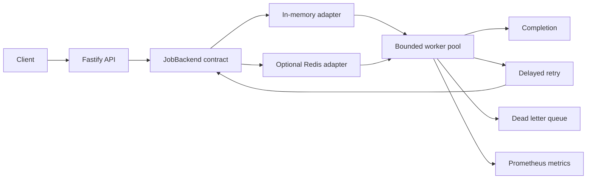

# Priority Job Queue and Dead Letter Queue Design

## Purpose

Build a standalone Node.js and TypeScript service that accepts expensive work over HTTP, processes it asynchronously with a bounded worker pool, retries transient failures without creating retry storms, and moves terminal failures to a dead letter queue (DLQ). The repository must be independently publishable, runnable without external infrastructure, and educational about data structures, concurrency, backpressure, failure handling, and delivery semantics.

The default backend is in memory. An optional Redis backend implements the same behavioral contract and demonstrates durability, multi-process coordination, leases, atomic transitions, and crash recovery. Redis is optional for local development but available through Docker Compose.

## Reasoning Gates

### Problem and workload

HTTP callers must not wait for slow work such as sending email, generating reports, resizing images, importing data, or indexing content. Producers may temporarily or persistently outpace consumers. The system therefore needs fast bounded admission, constant-time job lookup, efficient highest-priority selection, controlled concurrency, delayed retry scheduling, and explicit overload behavior.

The principal saturation points are worker concurrency, downstream capacity, the bounded outstanding-job limit, process memory in the in-memory backend, and Redis command or memory capacity in the Redis backend. If consumers remain slower than producers, the queue reaches its configured bound and new jobs receive `429 Too Many Requests`; the system never grows its queue without limit.

### Required operations

- Submit a validated job, optionally with an idempotency key.
- Retrieve a job by ID.
- Atomically claim the oldest ready job at the highest available priority.
- Renew or expire a processing lease.
- Complete, retry, or dead-letter only the currently owned attempt.
- Promote delayed retries when due.
- Reclaim work abandoned by crashed workers.
- Report queue state, worker state, health, and metrics.

### Retained state

The service retains job payloads and metadata, idempotency mappings, ready ordering, delayed retry times, active leases, attempt counts, sanitized failure summaries, terminal job records, and DLQ entries. In-memory state is intentionally lost on process restart. Redis state survives application restarts subject to Redis persistence and failover configuration.

## Architecture

The application contains the following focused components:

- **API:** validates requests, performs admission, reports status, health, and metrics.
- **Domain:** defines job states, priorities, errors, attempts, leases, and transition rules.
- **Job backend:** a storage-neutral contract for admission, lookup, claim, heartbeat, completion, retry, recovery, and DLQ transitions.
- **In-memory adapter:** provides the zero-infrastructure default using purpose-built collections.
- **Redis adapter:** provides durable shared coordination using Redis primitives and atomic Lua scripts.
- **Worker pool:** enforces fixed concurrency and timeouts and delegates state changes to the backend.
- **Retry scheduler:** calculates capped exponential backoff with jitter and promotes due work.
- **DLQ reconciler:** completes pending DLQ transitions after a transient insertion failure.
- **Observability:** emits structured logs and Prometheus-compatible metrics.

Purposeful boundaries allow both adapters to run against the same contract tests without hiding backend-specific health and recovery behavior.

## Data Structures and Algorithms

### In-memory adapter

- A `Map` provides average `O(1)` job lookup by ID.
- A second `Map` provides atomic-in-process idempotency-key lookup and insertion.
- A binary max-heap selects the highest priority ready job in `O(log n)`. A monotonic sequence number provides FIFO order among equal priorities.
- A binary min-heap exposes the next due retry in `O(1)` and inserts or removes delayed work in `O(log n)`.
- Maps keyed by job ID hold active lease tokens and expiry times. A set-like membership check prevents a job from occupying two local states.

Scanning an array for every claim would cost `O(n)` at the hottest operation. Sorting on every insertion would also add unnecessary work. A heap is justified because both enqueue and claim are frequent and queue size is deliberately configurable. Four FIFO queues would also be valid for the fixed priority set; the heap is retained in memory to demonstrate general priority-queue behavior and stable tie-breaking.

### Redis adapter

- A Redis hash stores each job record.
- One Redis list per priority preserves FIFO order within that priority.
- A sorted set schedules delayed retries by due timestamp.
- A sorted set tracks leases by expiry timestamp.
- Idempotency keys map to job IDs with a retention period aligned with terminal-job retention.
- Lua scripts atomically admit, claim, acknowledge, retry, dead-letter, renew, promote, and reclaim jobs.

Claiming checks priority lists from critical to low inside one Lua script. Selection, removal, status change, attempt increment, and lease creation are indivisible. The constant number of priorities makes selection `O(1)` plus Redis list and sorted-set costs; delayed and lease operations are `O(log n)`.

### Retry algorithm

For zero-based retry number `r`, delay is calculated as:

`min(maxDelay, baseDelay * 2^r) + jitter`

Jitter is sampled from a bounded configurable range using an injectable random source. Maximum attempts and maximum delay cap amplification and recovery time. Retryable and non-retryable errors are explicit domain types rather than inferred from arbitrary messages.

### Dynamic programming decision

Dynamic programming is not required. Selecting the next job depends on current priority and arrival order, not overlapping subproblems or an optimal-substructure recurrence. Memoization and bottom-up tables would add state without reducing the complexity of admission or claiming. A separate resource-allocation optimizer—for example, maximizing weighted completed work across heterogeneous workers under time and memory constraints—could use dynamic programming, but it is outside the core queue.

## Job State Machine

Normal processing follows:

`queued -> running -> completed`

Retryable processing follows:

`running -> retry_scheduled -> queued`

After a non-retryable error or exhausted attempts:

`running -> dead_lettered`

If a DLQ transition cannot be persisted:

`running -> dlq_pending -> dead_lettered`

The reconciler retries `dlq_pending` transitions. State transitions are idempotent and compare the active lease token before mutation.

## Race-Condition Mitigation

Every claim has a unique opaque lease token that acts as a fencing token for that attempt. Completion, heartbeat, retry, and DLQ operations succeed only if the submitted token still matches the active lease. If a lease expires and another worker reclaims the job, a late acknowledgement from the stale worker is rejected and cannot overwrite the newer attempt.

In memory, a synchronous claim transition completes before asynchronous handler work starts. In Redis, Lua makes each multi-key transition atomic. Admission combines capacity checking and outstanding-count updates atomically. Idempotency-key lookup and creation are also atomic, so concurrent matching requests create one job.

Contract and contention tests must prove that only one worker owns a job at a time, no job disappears between ready and leased states, stale acknowledgements fail, expired work is reclaimable, duplicate concurrent submissions create one record, and concurrent admission never exceeds capacity.

These controls do not provide exactly-once business execution. A worker can perform an external side effect and crash or lose its lease before acknowledgement. The system explicitly provides at-least-once processing and requires idempotent handlers or downstream idempotency keys.

## Performance and Backpressure

Configuration provides hard limits for request-body bytes, serialized job payload bytes, outstanding jobs, worker concurrency, job execution time, attempts, base and maximum retry delays, jitter, and terminal-record retention. Configuration validation prevents nonsensical or dangerous values, including unbounded workers.

The outstanding-job limit covers ready, delayed, running, and DLQ-pending jobs. Retries do not consume new admission slots because they already belong to the admitted population. Completed and dead-lettered jobs release outstanding capacity while their terminal metadata may remain available until retention cleanup.

When capacity is exhausted, `POST /jobs` returns `429` with retry guidance. Oversized HTTP bodies return `413`; malformed or semantically invalid jobs return `400`. Queue-utilisation thresholds emit structured warnings without logging one warning per request.

A producer rate of 10,000 jobs per second against 2,000 jobs per second of sustainable consumption fills the bounded queue at approximately 8,000 jobs per second. Once full, rejection protects memory, workers, Redis, and downstream services. Adding workers is safe only until the downstream dependency or local CPU becomes the limiting resource.

## Worker and Failure Behavior

The bounded worker pool starts no more than the configured number of handlers. Each execution has an abort signal and deadline. A timeout is classified as retryable unless its job type defines otherwise. Handler promises are observed after timeout so late rejection cannot become unhandled process rejection.

Test handlers support deterministic success, delay, retryable dependency outage, permanent failure, timeout, and idempotent side-effect simulation. Production-like handler registration is explicit; arbitrary code cannot be submitted in a job payload.

Redis workers renew long-running leases. A recovery loop finds expired leases and requeues them atomically. Backend disconnection stops new claims. Readiness becomes false until coordination is usable again.

DLQ insertion is part of a guarded backend transition. An injected in-memory failure and a Redis command failure leave recoverable state rather than silently discarding the job. The reconciler completes the transition when the backend can accept it.

## Consistency and Availability

The in-memory backend favors local availability and simplicity but loses all nonterminal work when the process exits. It cannot coordinate multiple application processes.

The Redis backend favors shared, durable coordination. During a Redis outage it rejects new admission and pauses claims rather than accepting work it cannot durably coordinate. Already-running handlers may finish their business side effect, but acknowledgement waits or fails and the lease can later be reclaimed, creating possible duplicate execution.

A job is considered complete only when its handler succeeds and the owning attempt's completion transition is stored. Status reads may lag external side effects and are therefore eventually consistent with the outside world. Exactly-once processing is not claimed.

## HTTP API

### `POST /jobs`

The JSON body contains a registered `type`, one of `critical`, `high`, `normal`, or `low`, and a JSON `payload`. An optional `Idempotency-Key` header deduplicates submission. A new job returns `202 Accepted` with its ID, state, and status URL. A repeated key returns the existing job and indicates deduplication.

Errors use a consistent machine-readable envelope. Admission exhaustion returns `429`, excessive bodies or payloads return `413`, malformed or invalid jobs return `400`, and an unavailable required backend returns `503`.

### `GET /jobs/:id`

Returns priority, state, attempts, timestamps, and a sanitized terminal or latest failure summary. Unknown IDs return `404`. Internal stack traces and backend details are never exposed.

### `GET /health`

Returns liveness, readiness, backend state, queue utilisation, and worker state. Redis mode returns `503` when Redis is required but unavailable. In-memory mode is explicit about its non-durable backend.

### `GET /metrics`

Returns Prometheus text exposition and tracks jobs received, admitted, rejected, completed, failed, retried, timed out, recovered, and dead-lettered; queue depth and utilisation; active workers; end-to-end job latency; processing latency; retry delay; and DLQ transition failures.

## Observability

Pino structured logs include job ID, type, attempt, priority, worker identifier, lease identifier in safely truncated form, transition, duration, and error classification. Payloads, secrets, and full idempotency keys are not logged. Repeated backend and utilisation warnings are rate-limited.

Metrics use a currently maintained Prometheus client selected and version-verified during implementation. Labels remain low-cardinality: job type and bounded outcome values are acceptable; job IDs and error messages are not.

## Testing

Jest unit tests cover domain validation, heap operations, priority ordering, stable FIFO ties, backoff, jitter bounds, and transition guards. Injectable clocks and random sources make time-sensitive tests deterministic.

Backend contract tests run against both implementations and cover submission, lookup, capacity, duplicates, claims, lease fencing, completion, retries, exhaustion, DLQ behavior, DLQ insertion failure, timeout state, expiry, and recovery. In-memory tests require no services. Redis integration tests use the Docker Compose test profile and a real Redis process.

Worker tests prove concurrency never exceeds its configured bound and simulate failures without timing races. API tests use Fastify injection. Contention tests launch competing claims and submissions to verify atomic behavior.

## Load Testing

`npm run load:test` uses autocannon-based scenarios for steady traffic, bursts, producer overload, slow workers, dependency outage, retry storms, and high connection concurrency. A reporter samples service metrics and process statistics to summarize request throughput, response latency, rejection rate, queue depth, job latency, processing latency, retry and DLQ rates, memory, CPU, and worker utilisation.

Load tests are experiments, not pass/fail microbenchmarks tied to one laptop. Each scenario documents expected qualitative behavior, especially bounded queue growth and non-amplifying retries.

## Deployment and Configuration

The repository includes a multi-stage Dockerfile and Docker Compose services for the application and Redis. The default application command uses memory. A Redis Compose profile enables the Redis adapter. Environment variables are parsed once into a typed immutable configuration.

Graceful shutdown stops admission, reports unready, stops claiming new jobs, waits up to a configured drain deadline, and then closes backend connections. In Redis mode, unfinished leases expire and are recoverable by another worker. In-memory shutdown cannot preserve unfinished work and documents that limitation.

## Build vs Buy and Alternatives

The README will compare the custom implementation with current maintained npm packages and verify package names, current versions, release activity, and official maintenance signals at implementation time. It will distinguish:

- BullMQ as a feature-rich persistent Redis-backed distributed job queue.
- `p-queue` as an in-process promise queue with concurrency and rate controls.
- `p-limit` as a small concurrency limiter rather than a durable queue.
- `p-map` as controlled-concurrency mapping over known inputs.
- `p-retry` as retry orchestration without queue storage or workers.
- `opossum` as a circuit-breaker primitive.
- the official `redis` client and `ioredis` as Redis connectivity libraries, not job queues.

The comparison covers what each package replaces, prioritisation, concurrency, retry support, distribution, persistence, operational burden, and when custom code is inappropriate. Infrastructure alternatives include managed queues and brokers at a high level without requiring them to run this project.

## Scaling Outlook

At roughly 10x load, Redis-backed horizontal workers, handler-specific concurrency, downstream rate limiting, connection tuning, and separate API and worker processes become appropriate. At roughly 100x load, queue partitioning, per-tenant fairness, admission quotas, dedicated scheduler and recovery processes, stronger Redis high availability or a purpose-built broker, and sampled observability become necessary. The single Redis coordination point and globally strict priority policy would require explicit capacity and starvation analysis.

The project intentionally does not implement multi-region consensus, exactly-once delivery, arbitrary workflows, cron scheduling, or a general-purpose broker. Those additions would obscure the bounded educational goal and are better served by established products.

## Acceptance Criteria

- The service runs with no external dependency using the in-memory adapter.
- Docker Compose can run the same service with the optional Redis adapter.
- Both adapters satisfy the same documented behavioral contract.
- All queue, concurrency, timeout, retry, DLQ, capacity, deduplication, and race-condition safeguards are executable and tested.
- The API and observability endpoints match this design.
- The repository includes deterministic Jest tests and autocannon load scenarios.
- The README explains the reasoning gates, algorithms and complexity, DP decision, failure and consistency semantics, operations, scaling, and verified alternatives.
- The repository remains lightweight, independently publishable, and free of dependencies on other practice projects.
